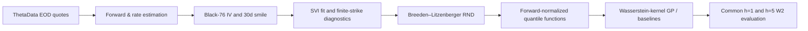
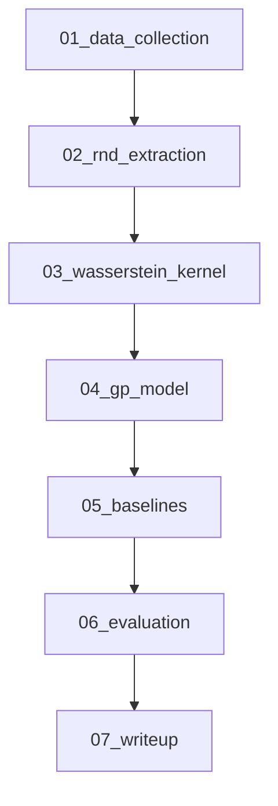
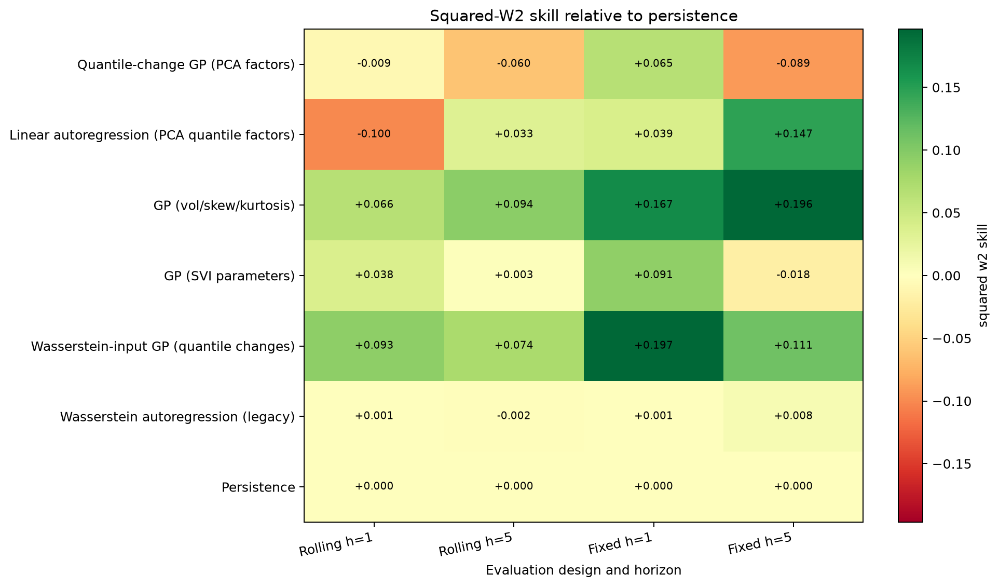
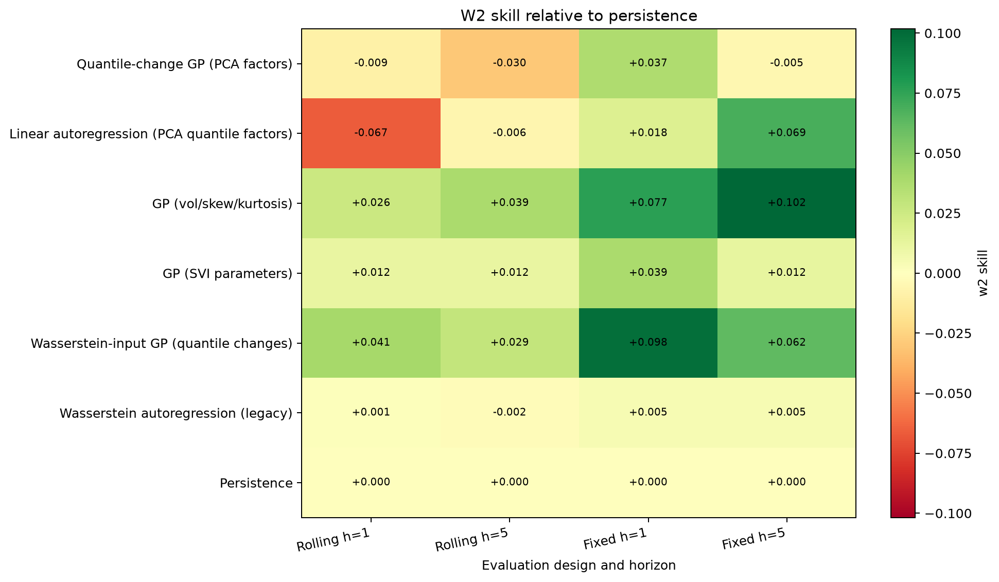
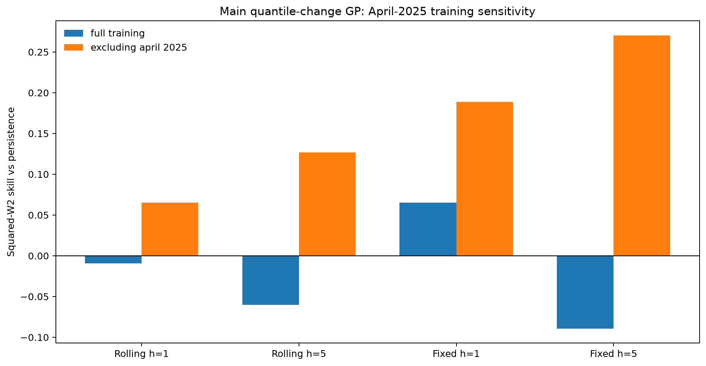
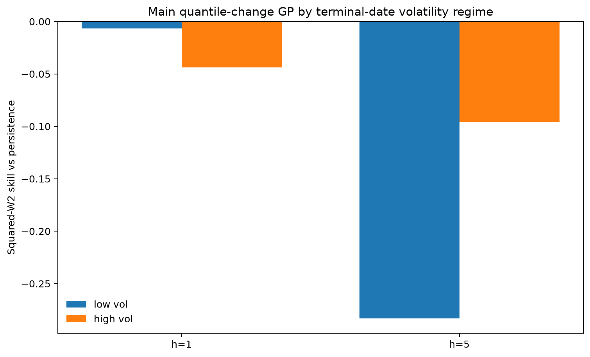
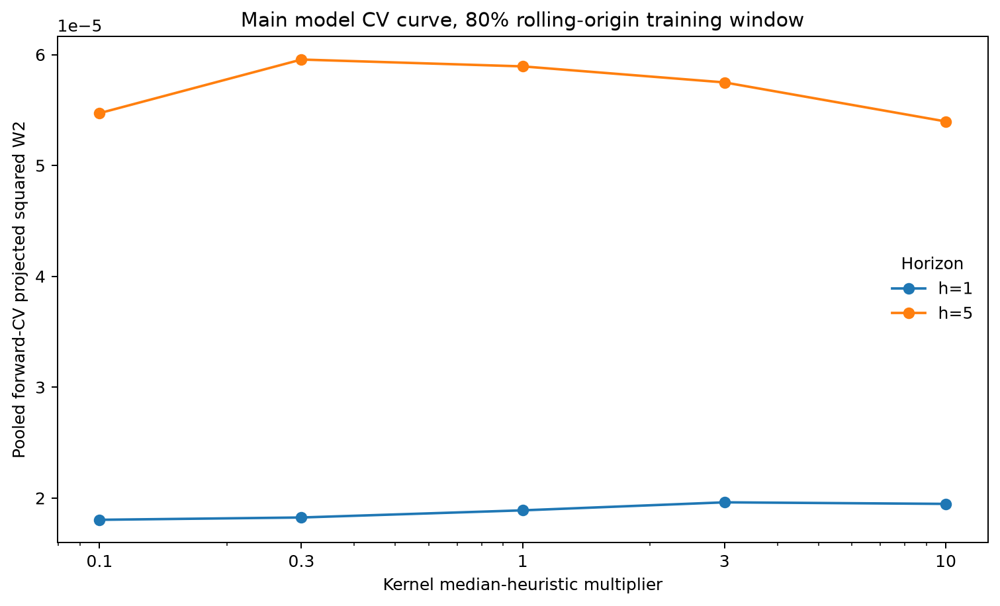
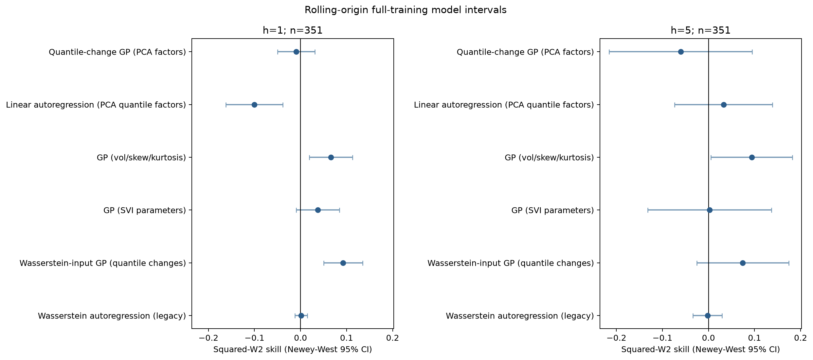
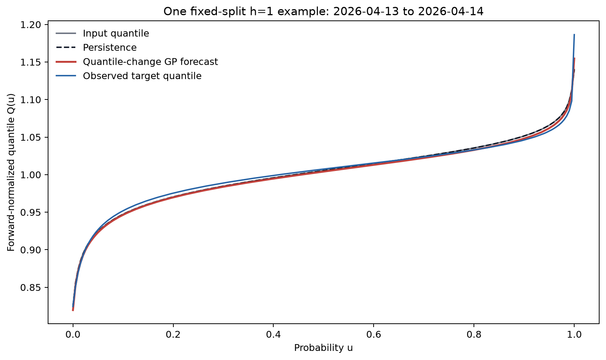
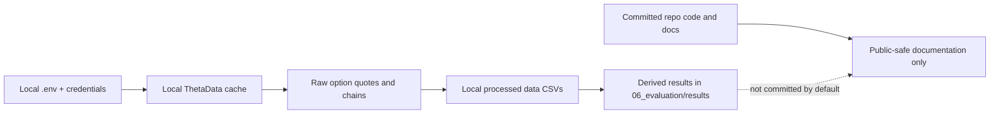

# Wasserstein forecasting of SPX risk-neutral densities

Private repository. Research pipeline, internal. Data-backed results come from ThetaData EOD options (2024-01-02 to 2026-11-04); do not make this repository public or redistribute raw quotes.

This project turns SPX option quotes into forward-normalized density forecasts and compares them with a shared Wasserstein-2 evaluation protocol. The code is organized by stage from data collection to evaluation, and every reported score is a descriptive pipeline result rather than an outperformance claim.

## The idea in 60 seconds



The pipeline extracts option-implied risk-neutral distributions (RNDs), represents them as quantile functions, and compares forecasted distributions with the 2-Wasserstein metric. The main Phase 4 model predicts the change in the quantile function, projects each forecast onto a valid quantile shape, and scores the projected forecast against persistence on the same shared pairs.

## Why quantile functions and W2

A distribution can be represented by its quantile function $Q(u)$ on $u \in [0,1]$. For two distributions $F$ and $G$, the Wasserstein-2 distance is

$$
W_2(F,G) = \left(\int_0^1 \left|F^{-1}(u)-G^{-1}(u)\right|^2 du\right)^{1/2}.
$$

The kernel used in the GP is the Gaussian-type kernel

$$
k(F,G)=\exp\{-\gamma \, W_2(F,G)^2\},
$$

where $\gamma$ is an inverse squared length-scale parameter. The key modeling choice is to forecast the change in the forward-normalized quantile function and then project that forecast back to a valid quantile function (nondecreasing, nonnegative, mean one), so every model is evaluated on the same support and persistence corresponds to the zero-change case.

## Pipeline stages



| Stage folder | Input | Output | Key checks |
|---|---|---|---|
| `01_data_collection` | raw/processed ThetaData option chains | merged SPX/SPXW chain, 30d smile, SVI params | root tagging, date-level caching, 30d bracketing, early-close diagnostics |
| `02_rnd_extraction` | smoothed call prices | extracted RNDs and quantile grids | no-arbitrage smoothing, martingale-tolerance checks, tail diagnostics |
| `03_wasserstein_kernel` | RND/quantile representations | W2 distances, kernel weights, barycenter utilities | numerical stability, normalized weights, fallback logic |
| `04_gp_model` | distribution objects and kernel | GP forecasts | training-window CV, kernel/noise selection, persistence comparison |
| `05_baselines` | same shared dates | persistence, moment, PCA, GP baselines | same chronological splits, same projection path |
| `06_evaluation` | all model outputs | evaluation summaries, inference tables, regime checks | h=1 and h=5 pair generation, NW and bootstrap inference |
| `07_writeup` | local result CSVs and scripts | documentation and figures | relative links, reproducible plots |

### Data-quality funnel

| Stage | Metric | Value |
|---|---:|---:|
| collection | attempted dates | 714 |
| smiles | dates with 30-day bracketing | 707 |
| smile failures | early-close and dead-expiry cases | 7 |
| martingale checks | dates excluded for tolerance miss | 9 |
| model comparison | common rolling-origin pairs | 351 per horizon |
| model comparison | common fixed 80/20 pairs | 143 per horizon |

The code keeps the full date stack available even when some dates drop out, and pairs are constructed from the trading calendar before date filtering so a missing date removes only the pairs that involve it.

## Models compared

| Model | Forecasts | Features | Role |
|---|---|---|---|
| Quantile-change GP (PCA factors) | change in forward-normalized quantile coefficients | PCA coordinates on quantile changes | main Phase 4 model |
| Linear autoregression (PCA quantile factors) | change in PCA coordinates | lagged PCA factors | reference linear comparator |
| GP (vol/skew/kurtosis) | change in distributional moments | vol, skew, kurtosis | compact moment GP |
| GP (SVI parameters) | change in SVI parameters | SVI coefficients | shape-based GP |
| Wasserstein-input GP (quantile changes) | change in quantile functions | kernelized distance inputs | distribution-aware GP |
| Wasserstein autoregression (legacy) | quantile trajectory | Wasserstein basis coordinates | continuity row |
| Persistence | prior quantile function | no model | baseline |

The main Phase 4 forecast is built on the change in a forward-normalized quantile representation; each forecast is projected to a valid quantile function with nondecreasing order, nonnegative density, and mean-one normalization. The zero-change case reproduces persistence exactly by construction.

## Evaluation protocol


The evaluation uses the NYSE/XNYS calendar before date filtering, which means a missing date removes only the pairs involving that date and never turns a next-day target into a multi-day one. Both horizons are always reported, and all models share the same date splits, transformation, and projection path.

The hyperparameter grid is fixed ahead of time as the median-heuristic multipliers {0.1, 0.3, 1, 3, 10}; the same forward-chaining time-series CV is applied to the model’s projected squared-W2 loss inside the training window, never on the test set. The saved files `06_evaluation/results/phase4_cv_loss_curve.csv` and `06_evaluation/results/phase4_selected_hyperparameters.csv` retain the full selection diagnostics.

## Results

### Rolling-origin and fixed 80/20 summaries for the main quantile-change GP

<!-- Source: 06_evaluation/results/phase4_forecast_summary.csv | columns: evaluation, training_condition, horizon_sessions, model, n_pairs, mean_w2, mean_squared_w2, skill_vs_persistence_w2, skill_vs_persistence_squared_w2 -->

| Evaluation | Horizon | n pairs | Mean W2 | Mean squared W2 | Skill vs persistence (W2) | Skill vs persistence (squared W2) |
|---|---:|---:|---:|---:|---:|---:|
| rolling-origin | h=1 | 351 | 2.917e-03 | 1.200e-05 | -9.03e-03 | -9.16e-03 |
| rolling-origin | h=5 | 351 | 4.093e-03 | 2.300e-05 | -2.99e-02 | -6.04e-02 |
| fixed 80/20 | h=1 | 143 | 2.556e-03 | 8.000e-06 | 3.68e-02 | 6.51e-02 |
| fixed 80/20 | h=5 | 143 | 3.597e-03 | 1.800e-05 | -5.21e-03 | -8.92e-02 |

The main quantile-change GP is close to persistence in rolling-origin h=1 and below persistence at h=5, while the fixed 80/20 split shows a positive h=1 skill in this sample and a negative h=5 skill. This is a descriptive pipeline comparison, not an outperformance claim.

### Heatmaps



Figure 1. Squared-W2 skill vs persistence by model, evaluation design and horizon. Descriptive pipeline comparison, not an outperformance claim. Sample sizes are 351 pairs for rolling-origin and 143 pairs for the fixed 80/20 split per horizon.



Figure 2. W2 skill vs persistence by model, evaluation design and horizon. Descriptive pipeline comparison, not an outperformance claim. Sample sizes are 351 pairs for rolling-origin and 143 pairs for the fixed 80/20 split per horizon.

### Training sensitivity and regime checks



Figure 3. Main quantile-change GP with full training versus excluding April 2025. Descriptive pipeline comparison, not an outperformance claim. The sample size is 351 pairs for rolling-origin and 143 pairs for the fixed 80/20 split per horizon.



Figure 4. Main quantile-change GP skill by low- and high-volatility terminal-date regime. Descriptive pipeline comparison, not an outperformance claim. The regime estimates are computed from the rolling-origin full-training sample.

### Model-selection diagnostics



Figure 5. Forward-chaining CV loss curve for the main model over the fixed kernel multiplier grid. Descriptive pipeline comparison, not an outperformance claim. The plotted loss is the projected squared-W2 loss on the rolling-origin training windows.



Figure 6. Newey-West 95% intervals for all models in the rolling-origin full-training evaluation. Descriptive pipeline comparison, not an outperformance claim. The zero line indicates no skill relative to persistence.



Figure 7. Example quantile forecast against the prior day and the realized target. Descriptive pipeline comparison, not an outperformance claim. The example is a single fixed-split h=1 pair from the saved Phase 4 predictions.

### Model comparison table (rolling-origin, full training)

<!-- Source: 06_evaluation/results/phase4_forecast_summary.csv | columns: evaluation, training_condition, horizon_sessions, model, n_pairs, mean_w2, mean_squared_w2, skill_vs_persistence_w2, skill_vs_persistence_squared_w2 -->

| Model | h=1 mean W2 | h=1 skill vs persistence (squared W2) | h=5 mean W2 | h=5 skill vs persistence (squared W2) |
|---|---:|---:|---:|---:|
| GP (SVI parameters) | 2.858e-03 | 3.75e-02 | 3.927e-03 | 2.53e-03 |
| GP (vol/skew/kurtosis) | 2.815e-03 | 6.58e-02 | 3.820e-03 | 9.38e-02 |
| Linear autoregression (PCA quantile factors) | 3.084e-03 | -1.00e-01 | 3.996e-03 | 3.26e-02 |
| Persistence | 2.891e-03 | 0.00e+00 | 3.974e-03 | 0.00e+00 |
| Quantile-change GP (PCA factors) | 2.917e-03 | -9.16e-03 | 4.093e-03 | -6.04e-02 |
| Wasserstein autoregression (legacy) | 2.887e-03 | 1.17e-03 | 3.983e-03 | -2.15e-03 |
| Wasserstein-input GP (quantile changes) | 2.774e-03 | 9.26e-02 | 3.860e-03 | 7.44e-02 |

This table is for the rolling-origin full-training setting and is meant to show the relative ordering in this sample. The sign and magnitude of skill are sensitive to the evaluation design and the exclusion of April 2025, so the project treats these results as descriptive rather than decisive.

### What the results show

- In this sample, the fixed 80/20 split gives a more favorable h=1 setup for the main quantile-change GP than the rolling-origin design.
- At h=5, the rolling-origin design is more negative for the main quantile-change GP than the fixed split, which highlights evaluation-design sensitivity.
- Excluding April 2025 improves the sign of skill for the main model in both evaluation designs, but the sign is not stable across all horizons.
- Regime dependence is present: low-volatility and high-volatility terminal-date samples do not respond identically to the same model configuration.

## How to read the outputs

| Output file | Purpose | Key columns |
|---|---|---|
| `06_evaluation/results/phase4_forecast_summary.csv` | main scored comparison across models, horizons and evaluation designs | `evaluation`, `training_condition`, `horizon_sessions`, `model`, `n_pairs`, `mean_w2`, `mean_squared_w2`, `skill_vs_persistence_w2`, `skill_vs_persistence_squared_w2` |
| `06_evaluation/results/phase4_inference.csv` | Newey-West and block-bootstrap inference results | `mean_skill`, `nw_se_skill`, `nw_ci_lower`, `nw_ci_upper`, `bootstrap_ci_lower`, `bootstrap_ci_upper` |
| `06_evaluation/results/phase4_cv_loss_curve.csv` | forward-chaining CV loss across gamma multipliers | `model`, `evaluation`, `horizon_sessions`, `gamma_multiplier`, `cv_squared_w2` |
| `06_evaluation/results/phase4_selected_hyperparameters.csv` | selected hyperparameters by split | `evaluation`, `horizon_sessions`, `selected_gamma_multiplier`, `selected_regularization_noise_ratio` |
| `06_evaluation/results/phase4_regime_summary.csv` | volatility-regime comparison | `volatility_regime`, `horizon_sessions`, `skill_vs_persistence_squared_w2` |
| `06_evaluation/results/pipeline_failure_report.txt` | qualitative diagnostics on date failures and numerical issues | date-level warnings, failed-smile causes, solver diagnostics |

Skill vs persistence is defined as

$$
\text{skill} = \frac{\text{loss}_{\text{persistence}} - \text{loss}_{\text{model}}}{\text{loss}_{\text{persistence}}},
$$

so positive values mean the model loses less than persistence on the chosen metric, while zero indicates parity with persistence. The saved CSVs report both W2 and squared W2 skills using the same convention.

## Data and reproducibility

The repository keeps raw option quotes, raw chains, derived market files, credentials, and local outputs out of Git. The committed repository is code and documentation; the research data remain local. The Phase 4 result CSVs that are used for figures and the README are part of the local evidence set, while the raw ThetaData files are excluded.



### Do not commit

- ThetaData credentials or `.env` files
- raw option quotes, raw chains, or parquets under `01_data_collection/data`
- any machine-specific cache or API session metadata
- generated plots or notebooks that contain raw market values

## Quick start

```powershell
# install dependencies
pip install -r requirements.txt

# run the repository test suite
python -m pytest

# synthetic demo only; does not pull SPX data
python run_all.py

# run the Phase 4 evaluation pipeline
python 06_evaluation/run_phase4_quantile_change.py

# regenerate figures from the saved Phase 4 CSVs
docs\make_figures.py
```

The figure-generation file is reproducible: it reads the saved Phase 4 result CSVs and writes the PNGs into `docs/figures/`.

## Repository map

```text
.
├── 01_data_collection/      # data collection, smile construction, SVI fitting
├── 02_rnd_extraction/       # Breeden–Litzenberger density extraction and diagnostics
├── 03_wasserstein_kernel/    # W2 kernels and quantile utilities
├── 04_gp_model/             # GP model fitting
├── 05_baselines/             # persistence and benchmark baselines
├── 06_evaluation/            # shared evaluation, inference and Phase 4 comparison
├── CODEBASE_GUIDE.md         # module map and stage responsibilities
├── docs/                     # figure generation script and saved PNGs
├── requirements.txt          # package requirements
├── run_all.py                # synthetic-data demo
├── README.md                 # project-level overview and result summary
└── tests/                    # repository unit tests
```

See [CODEBASE_GUIDE.md](CODEBASE_GUIDE.md) for module-by-module execution order and implementation notes.

## Limitations and open questions

- The sample length is limited to local ThetaData EOD data available in the active project scope: 2024-01-02 to 2026-11-04.
- The martingale-tolerance misses remain concentrated in a few dates and indicate the need for tail handling or a stricter extraction rule in some windows.
- Evaluation-design sensitivity remains visible: the fixed 80/20 split and the rolling-origin design do not agree perfectly on the sign of skill.
- The data-use terms and local access policy remain an operational constraint on redistribution, even when the code itself is tracked.
- A second density extraction method remains pending and is not included in the main results shown here.

## Glossary

- RND: risk-neutral density implied by option prices.
- SVI: stochastic-volatility-inspired parametric total-variance fit used for smile interpolation.
- W2: Wasserstein-2 metric, used for distributional distances and score evaluation.
- Barycenter: the forecast distribution formed by averaging quantile functions under the kernel weights.
- Skill: the relative improvement in loss versus persistence, computed on the same pair set.
- Rolling-origin: an expanding window evaluation where the training set grows over time and the holdout is always later in time.
- Forward-chaining CV: time-ordered validation folds used to select hyperparameters without leaking future information.

<details>
<summary>Previous README (preserved verbatim)</summary>

# Wasserstein Forecasting of Risk-Neutral Densities

This repository contains research code for extracting option-implied risk-neutral distributions (RNDs) and forecasting their evolution with a Gaussian process using a Wasserstein-distance kernel.

## Research Pipeline

```text
SPX option quotes
  -> forward and rate estimation
  -> Black-76 implied volatility
  -> 30-calendar-day total-variance interpolation
  -> SVI smile fitting
  -> arbitrage-constrained call-price smoothing
  -> Breeden-Litzenberger density extraction
  -> forward-normalized quantile representation
  -> Wasserstein-kernel GP and benchmark forecasts
  -> held-out Wasserstein-2 evaluation
```

The distributional distance is computed from quantile functions:

$$
W_2(F,G) = \left(\int_0^1 |F^{-1}(u)-G^{-1}(u)|^2\,du\right)^{1/2}.
$$

For the kernel $k(F,G)=\exp(-\gamma W_2(F,G)^2)$, $\gamma$ is an inverse squared length-scale parameter. A small value gives a broad, nearly constant kernel; a large value suppresses off-diagonal similarities. The implementation bounds its estimate around a median-distance heuristic and normalizes forecast weights, with a nearest-neighbour fallback for numerical collapse.

## Models

- Wasserstein-kernel Gaussian process with a quantile-barycenter full-distribution forecast
- Persistence forecast
- Linear baseline using distribution moments
- Wasserstein autoregression on quantile coordinates
- Conventional RBF Gaussian process using distribution moments
- Quantile-change forecasts with a shared valid-quantile projection, including PCA, moment, SVI, and Wasserstein-input comparators

The distribution-valued models are compared with common chronological evaluation pairs using full-density W2 error. The Phase 4 quantile-change evaluator uses rolling-origin evaluation as primary, a fixed 80/20 split as secondary, and forward-chaining training-only CV to select kernel and regularization settings. All generated scores are descriptive pipeline results, not claims of model outperformance.

## Data and Reproducibility

Market-data responses, generated chains, IV/RND datasets, and pilot-specific result artifacts are kept local and excluded from Git. Reproduction requires an appropriately authorized data subscription, a locally configured API key, the VolForge dependency, and compliance with the data provider's terms. Do not commit credentials, raw market data, or derived outputs without permission.

The SPX stages are run individually using the scripts under `01_data_collection/`, followed by `02_rnd_extraction/breeden_litzenberger.py`, `04_gp_model/fit_gp.py`, `05_baselines/`, and `06_evaluation/`. `run_all.py` is the separate synthetic-data demonstration; it does not fetch or process the SPX ThetaData pilot.

Install the general dependencies with:

```powershell
pip install -r requirements.txt
```

Configure the ThetaData/VolForge client locally before running the collection stage. Keep API credentials in environment variables or a local `.env` file, never in the repository.

## Repository Map

- `01_data_collection/`: synthetic data, option-chain adapters, 30-day smile construction, and SVI fitting
- `02_rnd_extraction/`: call-price projection, Breeden-Litzenberger extraction, and diagnostics
- `03_wasserstein_kernel/`: quantile conversion, W2 distances, kernels, and numerical checks
- `04_gp_model/`: Wasserstein-kernel GP and full-distribution forecasting
- `05_baselines/`: moment, persistence, Wasserstein autoregression, and moment-GP forecasts
- `06_evaluation/`: shared held-out comparison, quantile-change models, and evaluation utilities
- `07_writeup/`: report-generation source; data-backed outputs are local-only

See [CODEBASE_GUIDE.md](CODEBASE_GUIDE.md) for key modules and execution order.

</details>
